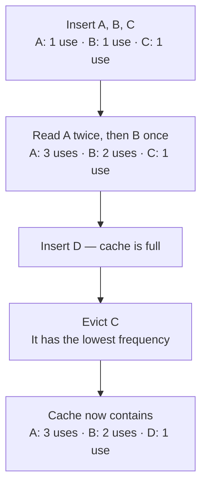
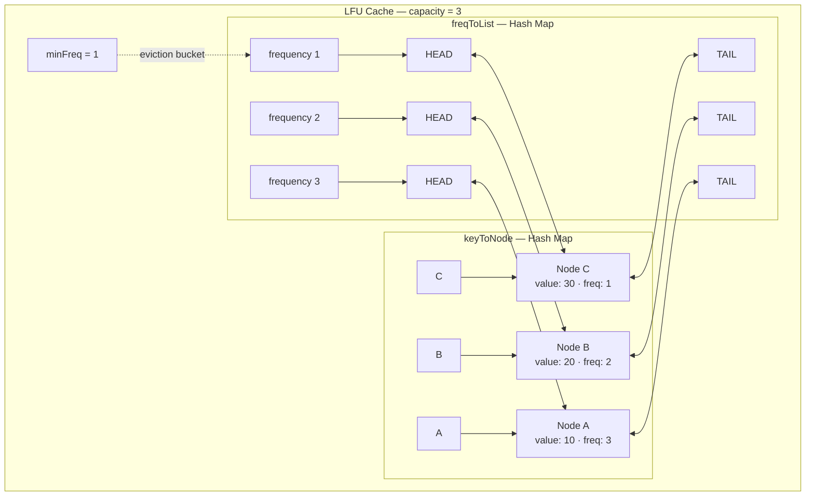

# LFU Cache: Behavior and Implementation

An **LFU (Least Frequently Used) cache** evicts the item accessed the fewest times. If items have equal frequency, a common implementation evicts the **least recently used** among them.

## How it works

Example: cache capacity **3**. New items start at frequency 1.



Items are grouped into **frequency buckets**:

```text
                  FREQUENCY BUCKETS
             Least recent → Most recent

frequency 1      [ C ]  ← minimum frequency: evict here
frequency 2      [ B ]
frequency 3      [ A ]

Read C:
  Remove C from frequency 1.
  Increase its count.
  Add C to the most-recent end of frequency 2.

frequency 2      [ B ] ⇄ [ C ]  ← minimum frequency
frequency 3      [ A ]

Insert D when full:
  B and C tie at frequency 2.
  Evict B because it was used less recently.
```

## Implementation structure

A typical **O(1) average-time LFU implementation** uses two hash maps, doubly linked lists, and `minFreq`:

- `keyToNode`: maps a key to its node for direct lookup.
- `freqToList`: maps a frequency to a doubly linked list of nodes.
- `minFreq`: tracks the lowest frequency currently in the cache.



**Each node is the same object referenced by both maps.** Every frequency list orders nodes from least recently used to most recently used. `HEAD` and `TAIL` are sentinel nodes.

```text
Node:
┌─────┬───────┬──────┬──────┬──────┐
│ key │ value │ freq │ prev │ next │
└─────┴───────┴──────┴──────┴──────┘

Frequency list:
HEAD ⇄ [least recent] ⇄ [...] ⇄ [most recent] ⇄ TAIL
         ↑ evict here              ↑ insert here
```

## Example: get(C)

Reading `C` moves its existing node between lists:

```text
BEFORE                          AFTER

freq 1: HEAD ⇄ C ⇄ TAIL          freq 1: empty → remove bucket

freq 2: HEAD ⇄ B ⇄ TAIL          freq 2: HEAD ⇄ B ⇄ C ⇄ TAIL
                                                    ↑ most recent
freq 3: HEAD ⇄ A ⇄ TAIL          freq 3: HEAD ⇄ A ⇄ TAIL

minFreq = 1                     minFreq = 2
C.freq = 1                      C.freq = 2
```

### get(key)

1. Look up the node in `keyToNode`. Return a miss if absent.
2. Remove the node from its current frequency list.
3. If that list is now empty, remove the bucket. If its frequency was `minFreq`, increment `minFreq` by 1: the accessed node will now occupy that next frequency.
4. Increment the node's frequency.
5. Append it before `TAIL` in the new frequency list, creating the list if needed.
6. Return its value.

### put(key, value)

1. If capacity is zero, do nothing.
2. If the key already exists, update its value and promote its frequency using the same steps as `get`. This is the convention used here.
3. Otherwise, if the cache is full:
   - Remove the first real node after `HEAD` in `freqToList[minFreq]`.
   - Delete its key from `keyToNode`.
   - Remove its frequency bucket if empty.
4. Create the new node with frequency **1**.
5. Add it to `keyToNode` and append it before `TAIL` in the frequency-1 list.
6. Set `minFreq = 1`.

## Complexity

| Operation | Average time |
|---|---|
| `get` | O(1) |
| `put`, including eviction | O(1) |
| Space | O(capacity) |

Hash maps provide average O(1) lookup, and doubly linked lists provide O(1) removal and insertion when the node is already known. No scan or sort is needed.

> Mermaid diagrams render in Markdown viewers with Mermaid support, including GitHub. The text diagrams remain readable in any text editor.


# sequence to follow
Change the value
Remove from the old frequency list
Update min_freq if needed
Increase the node's frequency
Create its new frequency list if needed
Append to the new list
Return